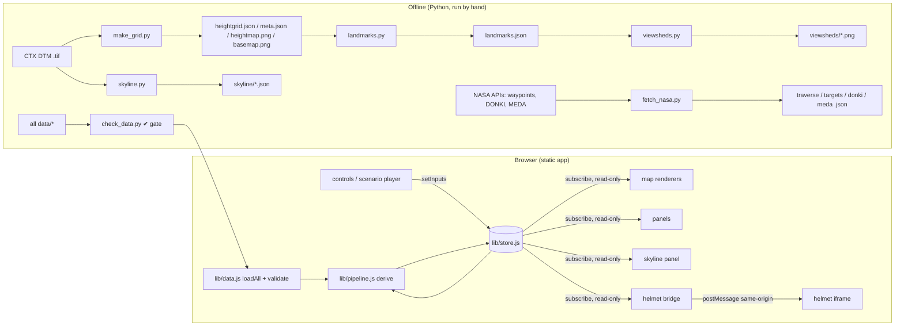

# Sightline — System Architecture

**Read this after `README.md`. If a feature README disagrees with this file, this file wins.**
Owner: Brayden (changes go through the team chat first).

---

## 1. Design principles (the rules everything else follows)

1. **Offline-first, static only.** The judged app is plain files on GitHub Pages. **Zero runtime calls to our own servers or to NASA APIs.** All NASA data is fetched and processed **once, offline, by Python**, then committed to `data/`. Runtime external dependencies are only: Mars Trek map tiles + 2 pinned CDN libraries + Google Fonts — and each has a fallback (section 8).
2. **One-way data flow.** UI and the demo player change **inputs**. One pipeline turns inputs into **derived** results. Renderers only read. Nothing that renders is allowed to write state.
3. **Pure maths, isolated side effects.** `computeLimits`, `computeBudget`, `planRoute`, `stateAt` are pure functions (same input → same output, no DOM, no fetch). They can be tested on their own and shared with the helmet view.
4. **Validate at every boundary.** Every file is checked when loaded. Bad or missing data fails **loudly** on screen — never silently.
5. **Truth labels everywhere.** Every science number comes from `data/crew_constants.json` with `isEstimate`. Every mock file shows a visible **MOCK DATA** badge. Nothing can pass as NASA data by accident.
6. **Deterministic demo.** The scenario is a pure function of time `t`. Scrubbing back and forth always gives the same screen — the 30-second video is reproducible.

---

## 2. System overview



---

## 3. Components and ownership

| Layer | Module | Owner | Kind | Responsibility |
|---|---|---|---|---|
| Offline | `scripts/*.py` | Sean, Brayden | batch | Produce every file in `data/` |
| Offline | `scripts/check_data.py` | Brayden | gate | Validate every contract in `data/` (must pass before submitting) |
| Core | `lib/geo.js` | Brayden | pure | Coordinates, distance, bearing, grid ↔ lat/lon |
| Core | `lib/store.js` | Brayden | state | Holds `{inputs, derived, data}`; the only place state lives |
| Core | `lib/data.js` | Brayden | I/O | Load + validate all `data/` files (real → mock fallback, records which) |
| Core | `lib/pipeline.js` | Brayden | orchestrator | Runs derive steps in fixed order; caches expensive steps |
| Model | `crew/budget.js` | Jojo | pure | `computeLimits`, `computeBudget` |
| Model | `route/route.js` | Jojo | pure | `planRoute` (A*) |
| Model | `map/visibility.js` | Brayden | pure + cache | `visibilityArrays(visKm)` from viewshed PNGs |
| Model | `map/scenario.js` | Brayden | pure | `stateAt(t)` → inputs for the demo |
| View | `map/map.js`, `map/panels.js` | Brayden | render | Leaflet layers, budget card, alerts, controls, sources modal |
| View | `skyline/skyline.js` | Brayden + Sean | render | Skyline Fix panel (reads precomputed results) |
| View | `helmet/*` | Edward | render | 3D view in an iframe, receives state by message |

**Rule:** only the owner edits a module. Everyone else uses its exported functions exactly as written in section 5.

---

## 4. State model

```js
store = {
  data:    { meta, grid, landmarks, targets, traverse, constants, scenario, skyline, viewsheds, status },  // loaded once, read-only
  inputs:  { ... },   // written ONLY by setInputs() (controls, scenario player, skyline fix)
  derived: { ... }    // written ONLY by lib/pipeline.js
}
```

### `inputs` (everything a user or the scenario can change)
| Field | Type / unit | Notes |
|---|---|---|
| `sol` | integer ≥ 0 | sols since landing |
| `ltst` | hours 0–24 (Mars local true solar time) | |
| `evaMin` | **Earth** minutes since EVA start | Mars hour = 61.65 Earth min |
| `astronaut` | `{lat, lon, headingDeg}` | the position the crew **believes** (best estimate) |
| `distSinceFixM` | metres walked since the last position fix | drives uncertainty growth |
| `fixUncertaintyM` | metres | uncertainty right after the last fix (30 m at home, Skyline Fix result later) |
| `tau` | dust optical depth, 0.1–10 | |
| `sepActive` | boolean | solar particle event |
| `pressurePa`, `tempC` | Pa, °C | |
| `sansAffected` | boolean | |
| `routeMode` | `'shortest' \| 'safest' \| 'homeInSight'` | |
| `target` | `{lat, lon, id?} \| null` | where the crew is heading (null = home) |
| `scenarioT` | Earth minutes \| null | null = free mode (sliders) |

### `derived` (computed, never set by hand)
| Field | From |
|---|---|
| `limits` = `{speedKmh, maxSlopeDeg, visibilityKm}` | `computeLimits(inputs, C)` |
| `posUncertaintyM` | `fixUncertaintyM + C.dead_reckoning_drift_pct/100 × distSinceFixM` |
| `vis` = `{blind, homeHidden, w, h, homeVisiblePct3km}` | `visibilityArrays(limits.visibilityKm)` |
| `routeOut` | `planRoute(... astronaut → target ...)` (null if no target) |
| `routeAlt` | `planRoute(... astronaut → target, mode = the other of safest/shortest ...)` for the comparison view (null if no target) |
| `routeHome` | `planRoute(... astronaut → home, mode = inputs.routeMode ...)` (the scenario's return leg always uses `'safest'`) |
| `routeHomeKm` | remaining length of `routeHome` from the astronaut |
| `budget` | `computeBudget(inputs, limits, routeHomeKm, C)` |
| `warnings` | data/mocks/validation problems to show on screen |

---

## 5. The pipeline (fixes the route ↔ budget circular dependency)

The walk budget needs the length of the route home; the route planner needs the slope limit and speed. That was a circle. It is broken by splitting the crew model into **limits** (no route needed) and **budget** (needs route):

```
setInputs(patch)
  └─► pipeline.derive(inputs, data, prevDerived)          // synchronous, fixed order
        1. limits   = computeLimits(inputs, C)                      [crew/budget.js]
        2. posUncertaintyM                                          [pipeline]
        3. vis      = visibilityArrays(round(limits.visibilityKm))  [map/visibility.js]  cached by key
        4. routeHome, routeOut = planRoute(...)                     [route/route.js]     cached by key
        5. routeHomeKm = remaining length along routeHome            [lib/geo.js]
        6. budget   = computeBudget(inputs, limits, routeHomeKm, C) [crew/budget.js]
  └─► store.derived = result  →  notify subscribers ONCE
```

### Function signatures (binding contracts)
```js
// crew/budget.js
export function computeLimits(inputs, C)                       // → { speedKmh, maxSlopeDeg, visibilityKm }
export function computeBudget(inputs, limits, routeHomeKm, C)  // → budget object (crew/README.md "Output")

// route/route.js
export function planRoute(grid, bounds, vis, start, goal, opts) // opts = { mode, maxSlopeDeg, speedKmh, maxExpansions = 400000 }
                                                                 // → route object (README section 6), never throws: { ok:false, reason } on failure

// map/visibility.js
export function initVisibility(viewsheds, landmarks, grid, bounds) // once, after data load
export function visibilityArrays(visKm)                            // → { blind: Uint8Array, homeHidden: Uint8Array, w, h, homeVisiblePct3km }

// map/scenario.js
export function stateAt(scenario, t, data)                     // → inputs patch for time t (pure, deterministic)

// lib/pipeline.js
export function derive(inputs, data, prev)                     // → derived
```

### Caching rules (keep it fast)
- **Visibility** recomputes only when `round(visibilityKm)` changes (≤ ~150 values) — cache by that key.
- **Routes** are replanned only when the **route key** changes:
  `mode | target | maxSlopeDeg | round(visibilityKm) | sepActive | floor(evaMin / 10) | astronaut rounded to 0.001° (~100 m)`.
  Small movements do **not** replan; between replans `routeHomeKm` = remaining length along the cached route + distance from the astronaut to the nearest route point.
- Budgets: A* ≤ 400k expansions (≈ < 300 ms); visibility ≤ 50 ms; one full `derive` ≤ 16 ms when caches hit.

### Store rules (prevents infinite loops)
```js
export function setInputs(patch)   // validates + merges into a NEW inputs object, runs derive, notifies once
export function subscribe(fn)      // fn(store) — read-only
export function getStore()         // returns the current frozen snapshot
```
- State objects are **replaced, never mutated** (`inputs = {...inputs, ...patch}`); snapshots are `Object.freeze`d.
- Calling `setInputs` **while subscribers are being notified throws** an error ("renderers must not write state"). Renderers that need to react (e.g. auto-open Skyline Fix) do it through a user action or the scenario, not inside a subscriber.
- `setInputs` rejects unknown keys and out-of-range values (`tau` 0.1–10, `ltst` 0–24, `sol` 0–1000, lat/lon inside `meta.bounds`) — it clamps numbers and logs a warning.

---

## 6. The demo scenario (deterministic)

- `scenario_demo.json` events are applied in order of `tMin` (ties: file order).
- `stateAt(scenario, t, data)` builds the inputs **from scratch for any `t`**: start state → apply every event with `tMin ≤ t` → place the astronaut along the planned legs.
- Legs are planned **once** and cached: outbound leg at `t = 0` (start → target); at `sep_onset` a return leg from the position at that moment → home (mode `safest`). Same inputs → same legs → same video every time.
- Movement speed along a leg = `computeLimits(...).speedKmh` at that time.
- `distSinceFixM` grows with distance walked; a `skyline_fix` event sets `fixUncertaintyM = skyline.uncertaintyM` and `distSinceFixM = 0`.
- Player clock: 1 real second = 2 EVA minutes (configurable), `requestAnimationFrame`, paused when the tab is hidden.

---

## 7. Data layer

### Loading (`lib/data.js`)
For each file: try `data/<file>` → if 404/invalid, try the mock (`map/mock/<file>.mock.json` or the module's own mock) → record `status[file] = 'real' | 'mock' | 'missing'`.
**Any `mock` or `missing` → a fixed "MOCK DATA: …" badge on screen.** The submission checklist requires zero mocks.

### Validation (browser `lib/data.js` and offline `scripts/check_data.py` check the same rules)
| File | Must hold |
|---|---|
| `meta.json` | bounds as in README; `home` inside bounds |
| `heightgrid.json` | `data.length === w*h`; **every value a finite number** (no NaN/null — Python must fill no-data before `json.dump`, because `NaN` is not valid JSON); `min ≤ value ≤ max` |
| `viewsheds/<id>.png` | one per landmark id; **exactly `w × h` of the grid**; values only 0/255 |
| `landmarks.json` | unique ids; `home` present; all inside bounds |
| `targets.json`, `traverse.json` | inside bounds; `traverse` sorted by sol |
| `crew_constants.json` | unique keys; **all keys the model needs exist** (list in `crew/README.md`); every `isEstimate:false` row has a non-empty, non-TODO `url` |
| `scenario_demo.json` | events sorted; `target` exists in `targets.json`; `skyline_fix.site` exists in `data/skyline/` |
| `skyline/<site>.json` | `observed.length === best.length === 360/azStepDeg`; `grid.rmsDeg.length === n*n` |

### Coordinate and unit conventions (one way only)
- Points in our files and functions: **`[lat, lon]`** arrays or `{lat, lon}` objects. GeoJSON's `[lon, lat]` order is converted **inside `fetch_nasa.py`** and never leaves it.
- Distances in **metres** internally; km only in UI text. Angles in **degrees**, azimuth 0 = north, clockwise.
- Time: `evaMin`, `tMin` = Earth minutes; `ltst` = Mars hours; `sol` = Mars days.
- Grid row 0 = north, col 0 = west; east–west metres × cos(lat).

---

## 8. Failure modes and fallbacks

| What fails | What the user sees | Mitigation |
|---|---|---|
| Mars Trek tiles slow/down during judging | Map still shows terrain | `data/basemap.png` (hillshade from the DTM, made by `make_grid.py`) is drawn under the tiles as an `L.imageOverlay` |
| A data file missing/invalid | MOCK DATA badge + warning list | loader fallback + validation messages |
| Route impossible (slopes) | "No safe route: all paths exceed 10° slope limit (sol 3 crew)" | `planRoute` returns `{ok:false, reason}` — it is a safety message, not an error |
| A* too slow | Route = last good route + note | `maxExpansions` cap |
| Helmet iframe not built yet / errors | Map app unaffected | iframe isolation; bridge ignores send failures |
| CDN (Leaflet/A-Frame) fails | Error card "Map library failed to load — reload" | pinned versions; `window.L` check at boot |
| JS exception in one renderer | Others keep working | each subscriber wrapped in `try/catch`, error shown in warnings |
| Browser without WebGL | Helmet button disabled with a note | feature check before opening |

---

## 9. Security and integrity

- **No secrets in the repo or the browser.** No API keys at runtime (all API data pre-fetched). DEMO_KEY used only offline. `check_data.py` greps `data/` for `api_key=` values other than `DEMO_KEY`.
- **postMessage is same-origin only.** Parent sends `iframe.contentWindow.postMessage(msg, location.origin)`. Helmet accepts a message only if `e.origin === location.origin && e.source === window.parent && msg.type` is one of the known types.
- **Message protocol (versioned):**
  - helmet → parent: `{ type: 'sightline:hello', v: 1 }` when ready
  - parent → helmet: `{ type: 'sightline:state', v: 1, inputs, derived: { limits, budget, routeHome, posUncertaintyM } }` (no big arrays — typed arrays are **not** sent)
  - parent replies to `hello` immediately with the current state, so the helmet never misses the first update.
- **No `innerHTML` with data.** All text from JSON is inserted with `textContent`. Source links are rendered only if they start with `https://`, with `rel="noopener noreferrer"`.
- **Pinned dependencies:** Leaflet 1.9.4 (cdnjs), A-Frame 1.6.0. No `@latest`.
- **Honest claims:** Skyline Fix results always carry their `method` text ("simulated skyline"). Budget factors always show NASA data / Estimate tags.

---

## 10. Loophole audit (what was wrong in the first specs and how it is closed)

| # | Loophole | Impact | Fix (where enforced) |
|---|---|---|---|
| 1 | `crew/wire.js` subscribed to the store and called `setState` inside the subscriber | infinite update loop / frozen tab | single pipeline (§5); `setInputs` throws during notify (`lib/store.js`) |
| 2 | Budget needs route length, route needs budget's slope/speed | circular dependency, undefined order | split into `computeLimits` → route → `computeBudget` (§5) |
| 3 | `Object.assign` mutated shared state | subscribers can't tell what changed; helmet gets half-updated objects | immutable snapshots, frozen (§5) |
| 4 | Route replanned on every change, incl. every movement tick | A* running 10×/s, lag | route key cache + 10-min refresh (§5) |
| 5 | `postMessage(..., '*')`, no origin check | any page could inject fake state into the helmet | same-origin + source + type checks (§9) |
| 6 | Helmet could load after the first state message | empty HUD | `hello` handshake (§9) |
| 7 | Python `json.dump` writes `NaN` for no-data | `JSON.parse` fails → app dead | fill no-data; validator (§7) |
| 8 | Viewshed PNG size could differ from the grid | wrong cells marked blind | size check in validator + loader (§7) |
| 9 | Mock fallback was silent | mock data could appear in the judged demo as NASA data | MOCK DATA badge + zero-mock gate (§7) |
| 10 | Mixed `[lon,lat]` (GeoJSON) and `[lat,lon]` (Leaflet) | points in the wrong place | one convention, converted only in `fetch_nasa.py` (§7) |
| 11 | Earth minutes vs Mars hours mixed | wrong LTST → wrong dust-devil/cold alerts | units table (§7) |
| 12 | Astronaut shown as an exact point | contradicts "no GPS" | believed position + uncertainty that grows with distance, reset by Skyline Fix (§4, §6) |
| 13 | Demo built by accumulating ticks | scrubbing back breaks; video not reproducible | `stateAt(t)` pure (§6) |
| 14 | Runtime dependence on NASA APIs (DEMO_KEY rate limits, CORS) | demo fails while judges watch | everything pre-fetched (§1) |
| 15 | Map tiles are an external dependency | blank map if Trek is down | local hillshade basemap (§8) |
| 16 | Constants could be missing / sources TODO while marked NASA data | silent `undefined` maths; false claims | required-keys check + url rule (§7) |
| 17 | Data from JSON put into HTML | injection | `textContent` only, https-only links (§9) |

---

## 11. Build order (dependencies)

1. `lib/geo.js`, `lib/store.js`, `lib/data.js` (with mocks), `lib/pipeline.js` with **stub** `computeLimits`/`computeBudget`/`planRoute` → the app runs end to end on mocks.
2. In parallel: real `crew/budget.js` (Jojo), real `route/route.js` (Jojo), `make_grid.py` → `landmarks.py` → `viewsheds.py` (Sean/Brayden), helmet on mock grid (Edward).
3. Swap stubs for real modules (same signatures — nothing else changes).
4. `skyline.py` + Skyline panel; scenario polish.
5. `check_data.py` passes with zero mocks → freeze → video → submit.
